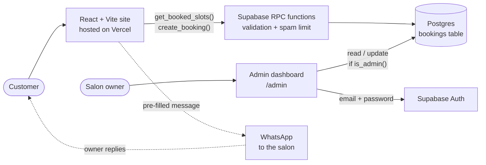

# Gloss Nail Studio

A booking website for a nail salon in Nairobi. Customers pick a style, choose a free day and time on a calendar, and send the booking to the salon on WhatsApp. The owner signs in to a private dashboard, sees today's clients first, and confirms or declines each request.

Live demo: https://nailshop-website-seven.vercel.app

## How it works



1. The customer chooses a style and an open slot. Taken slots are hidden.
2. The site calls `create_booking`. The database validates everything and saves the booking as **pending**.
3. A confirmation screen opens WhatsApp with the booking details pre-filled, so the salon hears about it straight away.
4. The owner opens the dashboard, sees **Today** (clients today and how many bookings still need an answer), and presses **Confirm** or **Decline**.

## Features

- Month calendar with past days, Sundays and anything beyond 60 days disabled
- Five daily time slots, Nairobi time
- Custom style option and an optional inspiration link
- Spam limit: a phone number can hold at most 2 upcoming bookings
- Two people can never take the same slot (enforced by the database)
- Owner dashboard with a Today view, a Pending, Confirmed, Done and Cancelled flow, and filters
- Gallery, contact page and a home page with a location map
- Responsive, with a mobile menu

## Tech stack

| Area | Choice |
| --- | --- |
| Front end | React, Vite, react-router-dom |
| Back end | Supabase (Postgres, Row Level Security, Auth) |
| Hosting | Vercel |
| Notifications | WhatsApp click-to-chat link |

## Security design

- The browser only holds the Supabase **publishable** key. The secret / service_role key is never used in this project and must never be added to it.
- Row Level Security is on for every table. Visitors cannot read the `bookings` table at all.
- Visitors only use two security-definer functions, `get_booked_slots` (returns taken times, no personal data) and `create_booking` (validates and inserts).
- Dashboard access needs a Supabase Auth login whose email is listed in the `admins` table. The `is_admin()` function checks this inside the database, so hiding the page in the front end is not what protects the data.
- A partial unique index (`booking_date, slot` where status is not cancelled) makes double booking impossible, even under simultaneous requests.

## Project structure

```
src/
  App.jsx             layout, header, footer, home page, routes
  Services.jsx        style gallery
  Book.jsx            calendar and booking form
  Contact.jsx         contact details and WhatsApp form
  Admin.jsx           owner dashboard
  brand.js            name, phone, location and map in one place
  supabaseClient.js   safe Supabase client
supabase.sql          full database setup
vercel.json           single-page-app rewrite
```

## Run it yourself

1. Create a Supabase project.
2. Open the SQL Editor and run `supabase.sql`.
3. In Authentication, create the owner user (email and password), then add that email:
   ```sql
   insert into public.admins (email) values ('owner@example.com');
   ```
4. Create `.env.local` in the project root:
   ```
   VITE_SUPABASE_URL=https://YOUR-PROJECT.supabase.co
   VITE_SUPABASE_ANON_KEY=YOUR-PUBLISHABLE-KEY
   ```
5. Install and start:
   ```
   npm install
   npm run dev
   ```
6. Deploy to Vercel, add the same two variables in the project settings, then run `npx vercel --prod`.

## Reusing it for another salon

Edit `src/brand.js`: business name, location, WhatsApp number, phone and map links. Replace the photos in `public/french manicure/` and the style list in `Services.jsx`. Add the new owner's email to the `admins` table. Nothing else in the code carries a business name.

## Status

Built and deployed as a portfolio project for a real-world salon booking workflow.
